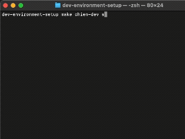
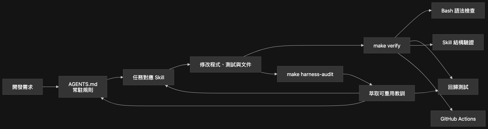

# chien-dev (dev-environment-setup)

<p align="center">
  
  
  
  
</p>

[English](./README.md) | [繁體中文](./README.zh-TW.md)

**chien-dev** 是一款標準化的開發環境腳手架。它支援 **容器 (DevContainer)** 與 **虛擬機 (Virtual Machine)** 雙後端，幫助你輕鬆配置與管理隔離的開發環境。

---

## 核心功能

- **雙後端支援**：在 **Docker (DevContainer)** 與 **虛擬機 (Multipass VM)** 之間無縫切換。
- **互動式建立**：透過友善的 CLI 自訂 OS 版本、開發語言與服務。
- **智慧資源偵測**：自動偵測宿主機 CPU/RAM/磁碟，提供最合適的 VM 配置建議。
- **SSH 安全自動化**：自動處理 VM 的 SSH 金鑰注入，實現免密登入。
- **環境醫生 (Doctor Check)**：內建檢查連接埠衝突與工具依賴性。

---

## 操作演示 (Demo)



---

## 安裝與使用

### 1. 安裝 (全域可用)

安裝 `chien-dev` 最簡單的方式是透過我們的一鍵安裝腳本：

```bash
curl -fsSL https://raw.githubusercontent.com/pong1013/dev-environment-setup/main/install.sh | bash
```
*(腳本會自動偵測你的作業系統，並詢問是否幫你安裝缺少的 Docker 或 Multipass)。*

### 2. 啟動前準備

如果你在安裝過程中跳過了依賴自動安裝，請手動安裝以下軟體：
- [Docker Desktop](https://www.docker.com/products/docker-desktop/) (用於容器模式)
- [Multipass](https://multipass.run/) (選用，用於虛擬機模式)

### 3. 建議的第一次流程

```bash
chien-dev doctor
chien-dev create <名稱>
chien-dev start <名稱> --project /專案/絕對/路徑
chien-dev status
```

### 詳細指令行為

- `chien-dev help`：顯示指令用法與範例。
- `chien-dev create <name>`：建立命名環境（互動式或透過環境變數）。
- `chien-dev start <name> --project /path`：啟動環境並將專案掛載至 `/workspace`（別名：`-p`；未提供時預設使用目前目錄）。
- `chien-dev status [name]`：顯示所有環境狀態或特定環境的詳細資訊。
- `chien-dev shell <name>`：進入容器 bash (容器模式) 或顯示 SSH 登入指令 (VM 模式)。
- `chien-dev stop <name>`：停止環境。
- `chien-dev clean <name>`：移除已停止的環境及其產生檔案；環境仍在執行時會拒絕清理。

若 Multipass 或外部工具（例如 local-k3s）移除了 VM，生成檔案仍會保留為本機紀錄，直到執行 `chien-dev clean <name>` 並確認（預設 **否**）。`status` 保持唯讀：只有可靠清單確認不存在時才顯示 `Missing` 與清理提示；無法可靠查詢 Multipass 時顯示 `Unknown`。清理消失的 VM 只移除其生成檔案。已停止或 `Deleted` 的 VM 會依指定名稱永久移除，不會全域清除其他已刪除實例。確認後會重新查詢，拒絕清理執行中、狀態不確定或重新出現的 VM；VM 刪除失敗時保留生成檔案。

- `chien-dev update`：比較目前執行的 Git 安裝版本 commit 與官方 GitHub `main` commit；若有新版，確認後才以 fast-forward 更新。更新需有互動式終端機，且安裝目錄須在乾淨的本機 `main` 分支；無法確認版本或狀態不安全時會拒絕更新。不支援非互動更新或 `--yes` 選項。

### 非互動模式 (適合 CI/CD)

帶入以下選項即可跳過提示：

```bash
# 建立 VM 環境並指定資源
chien-dev create my-node --env vm --cpus 4 --memory 4G --disk 20G

# 在容器中安裝特定語言與資料庫
chien-dev create my-dev --langs go,node --db postgres
```

| Option | 可選值 | 預設值 |
|-----|--------|---------|
| `--env`, `-e` | `devcontainer`, `vm` | `devcontainer` |
| `--os`, `-o` | `22.04`, `24.04` | `22.04` |
| `--langs`, `-l` | `go`, `node`, `python`, `java`, `php` | 無 |
| `--frontend`, `-f` | `react`, `vue`, `none` | `none` |
| `--db`, `-d` | `postgres`, `mysql`, `mongodb` | 無 |
| `--broker`, `-b` | `redis`, `rabbitmq`, `kafka` | 無 |
| `--docker-socket` | 掛載主機 socket；安裝 Docker CLI + Compose（僅 DevContainer） | 非互動模式不啟用 |
| `--no-docker-socket` | 停用 socket 存取 | - |
| `--docker-socket-path` | 主機 socket 絕對路徑；指定即啟用 | `/var/run/docker.sock` |
| `--cpus`, `-c` | VM 模式 CPU 數量 | `2` |
| `--memory`, `-m` | VM 模式記憶體大小 | `2G` |
| `--disk`, `-s` | VM 模式磁碟大小 | `10G` |

互動建立 DevContainer 時會詢問是否掛載 Docker socket，預設為 **是**。啟用後容器可以控制主機 Docker daemon，並從 [Docker 官方 Ubuntu 套件庫](https://docs.docker.com/engine/install/ubuntu/) 安裝 Docker CLI 與 Compose；不會在容器內安裝或啟動另一個 daemon。非互動建立預設不啟用；可使用 `--docker-socket` 啟用、`--no-docker-socket` 停用，或 `--docker-socket-path "/absolute/path/docker.sock"` 指定來源。互相矛盾的啟用／停用旗標，以及 VM 模式使用 socket 旗標，都會被拒絕。

容器內目標固定為 `/var/run/docker.sock`。來源路徑由 Docker daemon 所在主機解析，不一定是執行 CLI 的電腦；產生檔案時不必存在，但啟動容器時必須是可存取的 socket，系統不會自動建立來源目錄。Rootless 或遠端 Docker 可能需要自訂路徑及相符的存取權限。`docker run -v` 等命令的主機路徑也由該 daemon 主機解析。既有產生的環境不會改動；VM 安裝 Docker 另行追蹤。

---

## 環境測試

啟動環境後，你可以執行以下動作驗證：

```bash
# 容器模式：
chien-dev shell <名稱>
go version     # (或 node --version 等)

# 虛擬機模式：
# 執行 'chien-dev status' 中顯示的 SSH 指令
ssh ubuntu@<VM_IP>
```

---

## 程式碼結構

- `scripts/commands/`：CLI 指令處理邏輯。
- `scripts/generators/`：設定產生器 (`container_render.sh`, `vm_render.sh`)。
- `scripts/modules/`：共用的 Docker、VM 與網路偵測模組。

### 開發 Harness

Repository 慣例記錄在 `AGENTS.md`，特定任務的 AI 工作流程則放在 `.agents/skills/`。
完整開發驗證需要 Ruby 2.6 以上版本及其標準 YAML library。



此圖呈現本 repository 的開發 Harness 架構。受 gate 控制的 AI feature workflow 採用 [`pong1013/ai-workflow`](https://github.com/pong1013/ai-workflow) 維護的流程；流程本身請參考該 repository。

```bash
make verify         # 檢查 Bash 語法、回歸測試與 Skill 結構
make harness-audit TRUSTED=1  # 以清理過的輸入進行唯讀 Codex Harness review
```

每次 push 與 pull request 也會自動執行 `make verify`。

只有在你已檢查並信任目前 checkout 時才能執行 `harness-audit`。它只會從隔離的暫存目錄，把 allowlist 內且經過遮蔽的快照交給 Codex；ignored files、疑似機密路徑、符號連結及 allowlist 外的路徑都不會納入。這個盡力而為的遮蔽器涵蓋常見機密指派、含有帳密的 URL（包括 database URL）及 `Authorization` header。Codex 的 read-only sandbox 只能防止修改 repository，並不是機密資料隔離邊界。

---

## 授權條款

採用 MIT 授權條款。
